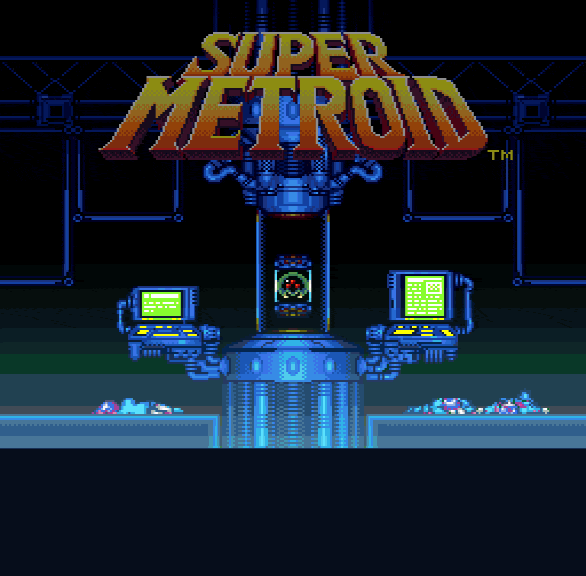

# SuperMetroidX



A static recompilation of Super Metroid for Windows, macOS, and Linux, and for iPhone, iPad, and Android. At build time, the 65816 program in your ROM is translated to C and compiled into the game. It runs on a cycle-timed SNES runtime (CPU, PPU, S-SMP, S-DSP, DMA, HDMA) that matches the Mesen 2 emulator frame for frame. The whole game plays from the intro to the end credits.

On top of the console's behaviour, which it leaves unchanged, the game adds:

- a picture that fills the screen at a television's 8:7 pixel shape, with CRT scanlines
- cleaner sound, through sinc interpolation and a long sinc resampler
- an in-game settings menu (`~`, or R3 on a gamepad) that saves your choices
- five optional cheats, and turbo at up to four times the speed for elevators and the end credits
- an intro you can skip by holding any button
- iPhone, iPad, and Android versions with touch controls in the Super Famicom's colors
- an Xcode project that builds, debugs, signs, and notarizes the Mac app
- quick-save states

## Build it yourself

SuperMetroidX is distributed as source code only. There are no downloads of the game, and there won't be: you build it from this repository with your own copy of the Super Metroid ROM.

That is the only way to make it without infringing Nintendo's copyright. Super Metroid's program, graphics, music, and sound are Nintendo's, and a build is made from them: the translator turns the ROM's code into C, and by default the ROM itself is linked into the program. So every build contains Nintendo's copyrighted work, and sharing one would be distributing the game. That is the kind of release that draws DMCA takedowns. This repository holds none of the game: no ROM, no code or data from it, and no generated translation of it, only the runtime, the translator, the shell, and the trailer above, which is footage of the game running. The ROM you supply never leaves your build folder.

Keep your builds and packages for your own machines, and **do not share them**. Use a ROM you dumped from a cartridge you own.

## Quick start

1. Install the tools for your system (below).
2. Clone this repository and put your ROM in its root as `SuperMetroid.sfc`.
3. Build and play:

   ```sh
   make play
   ```

   On Windows, run `build.bat play` from Command Prompt or PowerShell instead.

The first build translates the ROM, which takes a few minutes. Release builds start fullscreen. Press `~` (R3 on a gamepad) for the settings menu, F11 for a window, and Escape to quit.

## The ROM

You need a dump of the North American / Japanese cartridge, **Super Metroid (Japan, USA) (En,Ja)**. Without a copier header it is 3,145,728 bytes and has these hashes:

| | |
| --- | --- |
| CRC32 | `D63ED5F8` |
| MD5 | `21f3e98df4780ee1c667b84e57d88675` |
| SHA-1 | `da957f0d63d14cb441d215462904c4fa8519c613` |

Check it with `shasum SuperMetroid.sfc` (macOS, Linux) or `certutil -hashfile SuperMetroid.sfc SHA1` (Windows). A copy with a 512-byte copier header also works; its hashes differ. The PAL release and ROM hacks are not supported. Use the `.sfc` (or `.smc`) file itself, not a `.zip`.

To build from a ROM somewhere else, pass `SMX_ROM` to CMake, for example `make play CMAKE_ARGS=-DSMX_ROM=/path/to/rom.sfc`, or keep the file at `SuperMetroid.sfc` in the root.

The ROM is built into the game by default (`SMX_EMBED_ROM`), so the program needs no ROM file next to it. To leave it out and load the ROM when the game starts instead, configure with `-DSMX_EMBED_ROM=OFF`, for example `make play CMAKE_ARGS=-DSMX_EMBED_ROM=OFF`. The setting is remembered for that build folder until you change it.

## Tools

You need Git, CMake 3.25 or newer, Ninja, and a C11 compiler. macOS and Linux also use GNU make. CMake downloads and builds SDL3 itself, so the first configure needs an internet connection.

**macOS** (Apple Silicon or Intel), with [Homebrew](https://brew.sh):

```sh
xcode-select --install
brew install cmake ninja
```

**Ubuntu and Debian:**

```sh
sudo apt-get install build-essential git cmake ninja-build pkg-config \
  libasound2-dev libpulse-dev libpipewire-0.3-dev libudev-dev \
  libx11-dev libxext-dev libxrandr-dev libxcursor-dev libxi-dev libxfixes-dev \
  libxss-dev libxtst-dev libxkbcommon-dev libwayland-dev libegl1-mesa-dev libgl1-mesa-dev \
  libdecor-0-dev
```

SDL only uses the audio and display systems whose headers it finds when it is configured, so install them before the first build. If you add some later, run `make clean` and build again.

**Windows:** install Visual Studio with the **Desktop development with C++** workload and its CMake and Ninja components. From Command Prompt or PowerShell, use `build.bat`; it finds and activates the latest installed Visual Studio compiler automatically.

Alternatively, with [MSYS2](https://www.msys2.org), open the *MSYS2 UCRT64* shell and run

```sh
pacman -S git make mingw-w64-ucrt-x86_64-gcc mingw-w64-ucrt-x86_64-cmake mingw-w64-ucrt-x86_64-ninja
```

Run every `make` command from that shell. The Makefile and `build.bat` create the same build folders and packages.

## Build and play

```sh
make play      # Release build, then play SuperMetroid.sfc (fullscreen)
make release   # Release build only
make run       # Debug build, then play in a window
make test      # Debug build plus unit tests
```

On Windows, replace `make` with `build.bat`: `build.bat play`, `build.bat release`, `build.bat run`, or `build.bat test`. Set optional arguments as environment variables, for example:

```bat
set "CMAKE_ARGS=-DSMX_ROM=C:/Games/SuperMetroid.sfc"
set "ARGS=--scanlines off"
build.bat play
```

`make play` and `make run` take `ROM=path/to/rom.sfc` to play a different file, and `ARGS="..."` to pass options, such as `make play ARGS="--scanlines off"`.

The game is in `build/release/` after `make release`:

| System | Program |
| --- | --- |
| macOS | `build/release/SuperMetroidX.app` (the program inside is `Contents/MacOS/SuperMetroidX`) |
| Linux | `build/release/SuperMetroidX` |
| Windows | `build/release/SuperMetroidX.exe` |

Run it with no argument to play the ROM built into it. A ROM path on the command line, or in the `SMX_ROM` environment variable, plays that file instead. A build without the ROM built in loads `SuperMetroid.sfc` from the working directory or the save folder:

```sh
./build/release/SuperMetroidX                            # the built-in ROM
./build/release/SuperMetroidX path/to/SuperMetroid.sfc   # a ROM file
```

With the ROM built in, the game also starts from Finder or Explorer as it is. Without it, copy the ROM to `SuperMetroid.sfc` in the save folder (see [Saves](#saves)), where the game looks. To make an installable copy, see [Packages](#packages).

## Packages

`make package` (or `make dist`) builds Release, runs the tests, and puts one package for your system in `build/release/dist/`. On Windows, use `build.bat package` (or `build.bat dist`) instead:

| System | Package | Contents |
| --- | --- | --- |
| macOS | `SuperMetroidX-<version>-macOS-arm64.dmg` | A disk image to drag `SuperMetroidX.app` into Applications. The app bundle has its icon, version, game category, controller support, and macOS 11 as its minimum. |
| Windows | `SuperMetroidX-<version>-Windows-x86_64.zip` | `SuperMetroidX.exe`, a windowed program with its icon, version details, and a manifest (per-monitor DPI, UTF-8). The compiler runtime is linked in, so it needs no DLLs beside it. |
| Linux | `SuperMetroidX-<version>-Linux-x86_64.tar.gz` | `bin/SuperMetroidX` and `share/` in the usual layout: a desktop entry, icons from 16 to 512 pixels, and AppStream metadata. Copy `bin` and `share` into `~/.local` to add the game to the applications menu. |

Each package has a short `README.txt` for players and the GNU GPL as `LICENSE.txt`. The icon is drawn in code (`src/icon.c`), and `smxicon` writes it as `.icns`, `.ico`, and PNG files at build time. The metadata templates are in `packaging/`, filled in from the version in `CMakeLists.txt`. A Linux package runs on distributions with the same or a newer glibc than the one it was built on.

A package is a build, so it contains the ROM's translated code, and the ROM itself unless `SMX_EMBED_ROM` is off. As [above](#build-it-yourself), it is for your own machines. The app is not signed or notarized, which a build you make yourself doesn't need. To sign or notarize it anyway, use [Xcode](#xcode).

### Xcode

On macOS, `make xcode` writes an Xcode project to `build/xcode` and opens it. The first run takes several minutes while CMake configures SDL for Xcode. The `SuperMetroidX` scheme builds, runs, and debugs the game, with the repository root as its working directory. That includes breakpoints in the translated code, Instruments, and the GPU frame debugger. The project comes from CMake, so change `CMakeLists.txt` rather than the project's settings, which the next configure would overwrite.

The project signs the app for the Apple developer team of a signing certificate in your keychain, preferring a Developer ID certificate, and the configure step names the team it chose. To get a certificate, sign in to Xcode with your Apple ID (**Settings > Accounts**, a free account or a paid one), choose **Manage Certificates**, add an **Apple Development** certificate, and run `make xcode` again. The app then uses Xcode's automatic signing and the hardened runtime, and Debug builds still let the debugger attach. With no certificate, it is signed to run on your Mac only. If you belong to more than one team, choose one once with `make xcode TEAM=ABCDE12345`; the project keeps it. Choose the team here rather than in Xcode's **Signing & Capabilities**, because CMake rewrites the project whenever `CMakeLists.txt` changes.

**Product > Archive** makes a Release archive of the app. In the Organizer, **Distribute App > Direct Distribution** signs it with your Developer ID and has Apple notarize it. That needs a paid developer account. Notarizing uploads the app, and with it the game, to Apple. A notarized build is still a build of Nintendo's game, so as [above](#build-it-yourself), keep it for your own machines. **Custom**, then **Developer ID** and **Export**, signs it with your Developer ID without notarizing it. The App Store and TestFlight aren't supported: putting a build there would be distributing the game.

### iPhone and iPad

`make ios` builds the translator for your Mac, then writes an iOS Xcode project to `build/ios` and opens it. The game is built from your ROM as on the Mac, and signed the same way, for the team of a certificate in your keychain. In Xcode, choose a simulator, or your iPhone or iPad, as the run destination, and press **Run**. A device needs **Developer Mode** on (**Settings > Privacy & Security**) the first time. With a free Apple account, an app on a device stops opening after seven days until you run it from Xcode again; a paid account makes that a year. The simulator needs no account.

On iPhone and iPad:

- **Touch controls** in the colors of the Super Famicom sit beside the picture. The D-pad is on the left with L and R above it, so your left thumb reaches them while your right thumb fires. X, A, B, and Y are on the right in the SNES diamond, and Select and Start are at the bottom in the middle. Several fingers work at once. A thumb can slide from button to button, or rest between two buttons to press both, such as B and Y to run and shoot. A finger that lands on the D-pad keeps steering it even if it slides off.
- **Controllers:** a controller paired over Bluetooth (Xbox, PlayStation, or MFi) plays as on the Mac. The touch controls hide while you use it and come back when you touch the screen.
- **Cheats menu:** the button in the top right corner (or R3 on a controller) pauses the game and opens a menu of the cheats, in place of the desktop's settings menu. Each cheat is a switch you tap. Turbo's switch runs at the speed beside it, which you tap to change. All items is a **Give** button, since items are given once. **Done**, or a tap outside the menu, plays on.
- **Picture:** it fills the screen in landscape at the TV shape, with scanlines drawn by a Metal shader. The simulator can't run SDL's GPU renderer, so there the picture has no scanlines. Display and sound use the defaults.
- **Saves:** the game saves at save stations, and the save is written out whenever the app goes to the background.

The same rules apply as on the Mac: a build is for your own devices, and the App Store and TestFlight aren't supported.

### Android

`make android` builds the translator for your computer, then builds the game with the Android NDK and packs it into `build/android/SuperMetroidX.apk`. It needs the Android SDK with an NDK, a build-tools, and Android 15's SDK Platform (API 35), as Android Studio's SDK Manager installs them, and a JDK; Gradle and Android Studio itself aren't used. The SDK is found in its usual place (`~/Library/Android/sdk` on macOS, `~/Android/Sdk` on Linux), or set `ANDROID_SDK`. With build-tools older than 35 the build needs a JDK 17, which it uses when one is installed. The APK holds one ABI, `arm64-v8a`, which current phones and the emulator on Apple silicon or ARM Linux run; for an x86-64 emulator, use `make android ANDROID_ABI=x86_64`. It runs on Android 5.0 and later.

`make android-run` installs the APK on the phone connected over USB, with **USB debugging** on in **Developer options**, or on the running emulator. With neither, it starts your first virtual device from Android Studio's **Device Manager** (or the one named by `AVD=`), then opens the game. The APK is signed with the SDK's debug key, so it installs on your own devices but isn't for Google Play.

On Android, the game plays as on iPhone: in landscape, with the same touch controls, controller support, and cheats menu. The **Back** button also opens and closes the cheats menu, and **Home** leaves the game, which waits where it was. The picture goes through OpenGL ES, so it has no scanlines.

## Display

The picture fills the screen at the shape an NTSC television gave it, with CRT scanlines drawn by an OpenGL 3.2 shader built into the program. Each enhancement can be turned off:

| Option | Values | Default |
| --- | --- | --- |
| `--window-mode` | `windowed`; `borderless`, fullscreen at the desktop's resolution; `exclusive` (or `fullscreen`), fullscreen at its own display mode | `borderless` in release builds, `windowed` in debug builds |
| `--scale` | `fit` fills the window; `integer` keeps whole-number scales | `fit` |
| `--aspect` | `tv` shows pixels 8:7 wide, as a television did; `square` | `tv` |
| `--scanlines` | `on`, `off` | `on` |

For example, `SuperMetroidX --window-mode windowed --scale integer --aspect square --scanlines off` shows the raw picture in a window. Scanlines fade out when a window is too small to draw them, below about twice the SNES's 224 lines. Without OpenGL 3.2, the game draws through SDL's renderer without scanlines. `--help` lists every option, and the [settings menu](#settings-menu) changes them while you play.

## Sound

The console smooths every instrument sample with a Gaussian filter that softens the treble, then plays at 32040 Hz. By default the game keeps that sound's character but plays it cleaner:

| Option | Values | Default |
| --- | --- | --- |
| `--audio-interpolation` | `sinc`, an 8-tap windowed sinc; `cubic`; `gaussian`, the console's own filter | `sinc` |
| `--audio-resampler` | `sinc`, a 64-tap filter from 32040 Hz to the device's rate, flat to about 14.5 kHz; `sdl`, SDL's own conversion | `sinc` |

Only what you hear changes. The sound chip's registers, its echo buffer, and everything the game can read still come from the console's Gaussian filter. `--audio-interpolation gaussian --audio-resampler sdl` is the sound of version 1.0. The settings menu changes both while you listen.

## Controls

| SNES | Keyboard | Xbox-style gamepad | Super Metroid (default) |
| --- | --- | --- | --- |
| D-pad | Arrow keys | D-pad or left stick | Move, aim; Down twice for Morph Ball |
| X | S | Y (north) | Shoot |
| A | A | B (east) | Jump |
| B | Z | A (south) | Run |
| Y | X | X (west) | Item cancel |
| Select | Right Shift | Back / View | Item select |
| L / R | Q / W | Shoulders or triggers | Aim down / aim up |
| Start | Return | Start / Menu | Pause, map, equipment |

The gamepad follows the SNES layout by position, so the buttons' letters differ from the SNES's. The game's own controller setup screen remaps the actions.

| Key | Action |
| --- | --- |
| Escape | Quit (release builds ask first) |
| F11 or Alt+Return | Toggle fullscreen |
| F5 | Quick-save |
| F9 | Quick-load (`--load-state` starts from the quick-save) |
| 1 to 5 | Switch a cheat (see below) |
| 6 | Step through turbo's speeds (see below) |
| ~ (grave) | Open or close the settings menu; R3 (press the right stick) on a gamepad |

## Settings menu

`~` on the keyboard or R3 on a gamepad pauses the game and opens the settings menu over it. It has every display and sound option above and the cheats. Up and down choose; left and right, or Enter (A on a gamepad), change a setting; Escape (B) or `~` again closes it.

- Changes apply at once and are saved in `settings.ini` in the save folder (below). Cheats are not saved: they last until you quit.
- A new window mode asks to be kept and goes back by itself after ten seconds, so a mode your display cannot show undoes itself.
- **Reset to defaults** asks first, then puts every setting back and turns the cheats off.
- Options on the command line apply to that run over the saved settings and are not saved, unless you change the same setting in the menu.
- If the window ends up unusable (too small, too large, or off screen), start the game with `--reset-settings` to forget the saved settings, or delete `settings.ini`.

## Skipping the intro

A new game opens with the intro, a few minutes of story. Hold any button for a second and a half, on the keyboard or a gamepad, to skip it: a bar in the bottom right fills while you hold, and letting go before it is full keeps watching. The game fades out and starts at Ceres Station, saved just as it would be after the whole intro. A quick tap still turns the intro's pages as usual.

## Cheats

Cheats are off until you turn them on, in the settings menu, with a number key in play, or with `--cheats` on the command line, such as `SuperMetroidX --cheats life,fly` or `--cheats all`. A message in the bottom left of the picture says when one turns on or off.

| Key | `--cheats` | Cheat |
| --- | --- | --- |
| 1 | `life` | Infinite life: energy and reserve tanks stay full. Samus still flinches when hit. |
| 2 | `ammo` | Infinite ammo: missiles, super missiles, and power bombs stay full, with 99 of each kind before its first expansion. |
| 3 | `items` | All items: every item, beam, tank, and expansion, full, given once, with every beam equipped but Spazer (the game won't combine it with Plasma). Ammo then counts down as usual unless `ammo` is on. While the hyper beam is on it stays the only beam; switching it off equips these. |
| 4 | `hyper` | Hyper beam: given as Mother Brain's fight gives it, with Charge, Wave, and Plasma equipped and the rainbow. Off again brings back the beams you had. |
| 5 | `fly` | Fly mode: hold jump to rise. Walls and ceilings still stop Samus; let go to fall. |
| 6 | | Turbo: runs the whole game 1.5, 2, 3, or 4 times as fast, to hurry through elevators, long doors, and the end credits. The music and sound speed up with it. Each press of 6 steps to the next speed and then back off; in the menu, left and right choose. |

Cheats work as a cheat cartridge does: between frames, the shell writes the game's memory, and the game does the rest. Turbo writes nothing: it runs the console's frames sooner. Items given by a cheat stay in your save if you then save at a save station.

## Saves

The cartridge's battery-backed SRAM is kept as `SuperMetroid.srm` in the save folder:

| System | Save folder |
| --- | --- |
| macOS | `~/Library/Application Support/SuperMetroidX/SuperMetroidX/` |
| Windows | `%APPDATA%\SuperMetroidX\SuperMetroidX\` |
| Linux | `~/.local/share/SuperMetroidX/SuperMetroidX/` |

The game saves at save stations as it would on a console, and the file is updated within a second. A `.srm` from an emulator such as Mesen works if you give it the ROM's name. Quick-save states go next to it as `SuperMetroid.state`. They hold everything but SRAM, so loading one never undoes the game's own saves, and a state only loads into the build and ROM that made it. Set `SMX_DATA_DIR` to keep saves somewhere else, such as next to a portable install.

## Troubleshooting

- **"Cannot load the ROM"**: the game did not find the file. Pass its path, or put it at one of the places the message names.
- **The build says the translation is of a different ROM, or the game runs slowly**: the ROM the game loaded is not the one it was built from, so it interprets the code instead of running the translation. Rebuild with the ROM you play.
- **No sound on Linux**: SDL was configured before the audio headers were installed. Install them, then `make clean` and build again.
- **A crash**: `make debug` runs the Debug build under lldb (macOS) or gdb (Linux) and prints every thread's backtrace. Please include it in an issue.

## Development

```sh
make build     # Debug, -O0, debug symbols
make test      # Debug build plus unit tests, and the ROM tests when a ROM is given
make debug     # Debug build under lldb or gdb; backtrace on a crash
make fmt       # clang-format
make docs      # Doxygen HTML in docs/html
make clean
```

[AGENTS.md](AGENTS.md) has the project's conventions. `make fmt` needs clang-format, and `make docs` needs Doxygen.

The first build caches what the translator found in `build/<config>/game/trace.txt`, so later builds reuse it. Configure with `-DSMX_RECOMP_TRACE=OFF` to translate from static analysis alone. Without a ROM, the build still succeeds: the game links an empty translation and interprets everything. `SuperMetroidX --smoke` opens the window, presents a few frames, and exits; CI runs it with `SDL_VIDEODRIVER=dummy`.

`make test` and `make test-release` take `CTEST_ARGS`, and `make` takes `CMAKE_ARGS` for CMake settings. With a ROM, CTest also runs the tests labelled `rom`; `make test CTEST_ARGS="-LE rom"` skips them:

- `game_idle`, `game_new-game`, `game_interpreted`: the game from power-on, left alone and through a new game into Ceres, checked against picture and audio hashes in `tests/game_hashes.h`, recorded from a build that matched Mesen 2. The interpreter must give the same hashes as the translation.
- `section_<name>`: `smxsave` reaches play from each play-test section.
- `smoke_rom`: the game starts on its built-in ROM, or on the file without one, and runs only translated code.

### CI

GitHub's hosted runners build and test Debug on Ubuntu, macOS, and Windows with `SMX_EMBED_ROM=OFF`; they never have the ROM. The one exception is the `raspberry-pi (ROM)` job, which runs on the owner's self-hosted Raspberry Pi 5 (runner labels `self-hosted, Linux, ARM64, smx-rom`). There the ROM is built in, and both Debug and Release run every test, including the `rom` ones. The ROM and the build trees stay on the Pi. Jobs run only for this repository and its own branches, never for forks or pull requests from forks, and a job-started hook on the Pi refuses any job not started by the owner. All four jobs must pass before a pull request merges.

### Play testing

`playtest.sh` starts the game in play at a chosen section, skipping the intro and Ceres:

```sh
./playtest.sh norfair                 # the first Norfair save station, with Varia
./playtest.sh maridia --items screw   # add items or beams to the section's loadout
./playtest.sh --debug tourian         # under lldb or gdb, with a backtrace on a crash
./playtest.sh --keep norfair          # continue the last Norfair session
./playtest.sh --cheats all landing    # with cheats on (see Cheats)
./playtest.sh --list                  # sections and loadout options
```

The sections are `ceres`, `landing`, `crateria`, `brinstar`, `norfair`, `wrecked-ship`, `maridia`, and `tourian`. Each starts with clear progress flags: bosses are alive and the Wrecked Ship is unpowered. The script uses `smxsave`, which plays the ROM headless: the game formats its own SRAM, slot A is written at the section's save station with its loadout, and the tool presses through the title and file select to a quick-save state in play. Saves and states from a play test stay in `build/playtest/<section>/`, apart from your own.

### The translator

`smxrecomp` is the command-line front end to the translator library in `include/smx/translate.h`:

```sh
smxrecomp [--no-trace] [--seeds FILE] ROM OUTDIR
```

It decodes code from the reset and interrupt vectors, follows branches, calls, and jump tables while tracking the M, X, and E flags, and adds the entry points its trace reached. Each straight-line run of instructions becomes a C function with a label per instruction. The generated code calls the same cycle-timed CPU operations as the interpreter. Code the translator never found, such as code in RAM, still runs in the interpreter. The game logs how many instructions ran each way when it exits, and records untranslated entry points in `<save folder>/SuperMetroid.coverage`; configure with `-DSMX_RECOMP_SEEDS=<that file>` to translate them too.

SDL3 `release-3.4.18` is fetched and compiled as a static library by CMake.

## License

SuperMetroidX is free software: you can redistribute it and modify it under the terms of the [GNU General Public License, version 3](LICENSE), as published by the Free Software Foundation. It comes with no warranty.

The license covers this repository's source code. It does not cover Super Metroid, your ROM, or anything made from the ROM, such as the translation under `build/` and the builds and packages that contain it. Those stay Nintendo's work, and the GPL grants no right to share them. SDL3 is under the zlib license.

Super Metroid is a trademark of Nintendo. SuperMetroidX is not affiliated with or endorsed by Nintendo.
